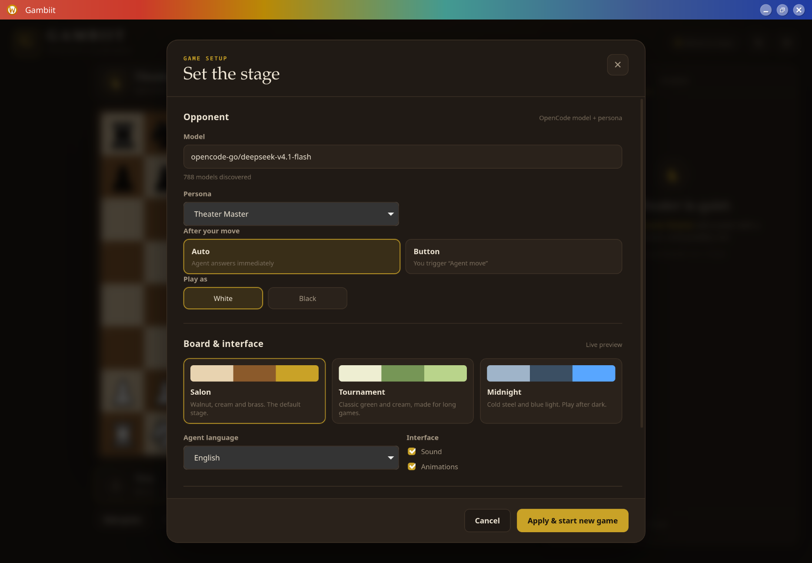

# Gambiit

A Rust-based desktop chess game where your opponent is an OpenCode model — with a
personality, a plan, and a taste for theater.

> **The board is truth; the voice is free.**
> Move legality, checkmate and results are always verified by the game. The agent
> may bluff about evaluations and plans, but never about the mechanics.


## Status

**Desktop UI milestone complete** — a playable Tauri app with a real OpenCode
opponent. The terminal prototype remains as a fast test harness. See
[`PLAN.md`](PLAN.md) for the full architecture and roadmap.

What works now:

- complete chess rules via `shakmaty` (castling, en passant, promotion, mate,
  stalemate, threefold repetition, 50-move rule, insufficient material);
- Tauri 2 + Svelte 5 desktop window;
- click-to-move board with legal-move dots, capture rings, last-move highlights,
  check marks, promotion picker and three themes;
- Cburnett SVG piece set and a polished theater-inspired layout;
- Stockfish 19 hybrid play: the engine proposes candidate moves, the model
  chooses and explains;
- OpenCode prompt transport with strict JSON validation and retries;
- automatic agent replies after the human move, or an “Agent move” button;
- session reuse across moves, so the opponent remembers the game;
- commentary cards with evaluations, candidate moves, rejection reasons, plan,
  elapsed time and token usage;
- takeback policy enforced per `AGENTS.md`: only your own last move is undoable;
- settings for model, persona, response mode, colour, theme, language, sound,
  animations, Stockfish depth and candidate count;
- desktop and terminal builds share the same Rust core, engine and agent layers.

Not yet: game persistence/resume, PGN library, clocks, post-game analysis, theme
editor, custom piece sets, MCP mode, chat, Truth Lens and broadcast mode. Those
are the next phases in `PLAN.md`.

## Run the desktop app

```bash
pnpm install
pnpm tauri dev
```

For a release build:

```bash
pnpm tauri build
```

`pnpm tauri dev` starts Vite and the Tauri window. The first move may take a few
seconds while the model thinks; the UI stays responsive and shows a thinking
indicator.

## Customize

The Settings panel controls the opponent model, persona, Auto/Button response
mode, playing colour, board theme, language, sound, animations and Stockfish
candidate depth. Three themes ship now: Salon, Tournament and Midnight. The
theme editor and custom piece-set folders are the next design milestone.



## Requirements

- Rust (stable, 1.85+; tested on 1.99)
- [OpenCode](https://opencode.ai) for AI opponents:
  - **OpenCode Desktop 2.x is recommended.** Gambiit auto-discovers its
    `opencode-cli` and uses the running desktop service, so it shares the same
    working authentication as the app.
  - A standalone `opencode` CLI also works; set `OPENCODE_BIN` if discovery
    picks the wrong binary.
- **Stockfish** for hybrid play and analysis — strongly recommended
  - Arch/CachyOS: `sudo pacman -S --needed stockfish`
- A model provider. The default is `opencode-go/deepseek-v4.1-flash`. A local
  Ollama model works offline:
  - `ollama/gemma4`
  - `ollama/qwen3.8:27b`
  - `localai/qwen3.8-9b-q8`

## Quick start

```bash
cargo build --release

# Check OpenCode and Stockfish
cargo run -p gambiit-cli -- probe

# Prove the OpenCode transport works (small prompt, no game)
cargo run -p gambiit-cli -- probe --prompt

# Play as White against the default OpenCode model
cargo run -p gambiit-cli -- play --agent opencode --color w

# Or use a local model
cargo run -p gambiit-cli -- play --agent opencode --model ollama/gemma4 --color w

# Play against Stockfish only, or against a mock opponent
cargo run -p gambiit-cli -- play --agent stockfish --color w
cargo run -p gambiit-cli -- play --agent mock --color w

# Perft sanity check
cargo run -p gambiit-cli -- perft 4
```

Useful options:

```bash
cargo run -p gambiit-cli -- play --help
# --depth 12 --multipv 3      Stockfish search settings
# --no-stockfish              legal-moves-only mode
# --max-plies 20              stop after N plies
# --persona "Trickster"       persona for the prompt
# --language en|et            agent commentary language
# --timeout 180               OpenCode request timeout
```

In the terminal, type a move as SAN (`e4`, `Nf3`, `O-O`) or UCI (`e2e4`,
`g1f3`). Type `moves` to list legal moves, `fen`, `pgn`, `resign`, or `q`.

`probe` prints which OpenCode binary Gambiit chose. The desktop `opencode-cli`
is preferred because it talks to the running OpenCode Desktop service and uses
the app's working authentication. If only the standalone `opencode` CLI is
available and its provider key has expired (`api_key_expired`), re-authenticate
with `opencode auth login`, choose another provider, or use a local Ollama
model. Gambiit never stores provider keys; OpenCode owns authentication.

## How it works

```
human move
   ↓
GameService (shakmaty) ── legal moves + FEN + history
   ↓
Stockfish (MultiPV 3) ── candidate moves + evaluations
   ↓
OpenCode prompt ── strict JSON: move, comment, candidates, plan
   ↓
validation (shakmaty) ── illegal/malformed → retry once → pause
   ↓
board + commentary
```

The agent is allowed to be theatrical. The game is not: every move returned by
the model is validated against the legal move list before it reaches the board.

## Development

```bash
cargo fmt --all
cargo test
cargo clippy --all-targets -- -D warnings
```

The terminal prototype is deliberately small. It is the risk spike that proves
the rules, Stockfish integration and OpenCode contract before the UI is built.

## Roadmap

- **Phase 1–2:** Tauri 2 + Svelte 5 shell, local two-player board, save/resume.
- **Phase 3:** agent in the UI: Auto / Button / Manual modes, model and persona
  selection, commentary panel, error recovery.
- **Phase 4:** themes, piece sets, theme editor, animations, sounds,
  accessibility, English/Estonian UI.
- **Phase 5:** PGN, clocks, takeback rules, draw/resign, analysis, result screen.
- **Phase 6:** MCP mode, personas/chat, Truth Lens, Director's Cut, leaderboard,
  broadcast mode.
- **Phase 7:** packaging (PKGBUILD, `.desktop`), docs, performance.

## License

TBD. Code and bundled assets will be licensed separately; chess piece sets and
sounds must carry their own license files.
