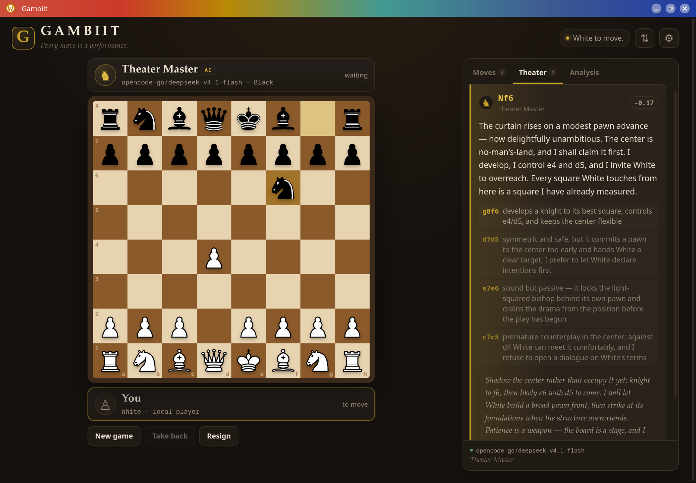

# Gambiit

A Rust-based desktop chess game where your opponent is an OpenCode model — with a
personality, a plan, and a taste for theater.

[github.com/reiokr/gambiit](https://github.com/reiokr/gambiit)

> **The board is truth; the voice is free.**
> Move legality, checkmate and results are always verified by the game. The agent
> may bluff about evaluations and plans, but never about the mechanics.



**Eestikeelne tööplaan:** [`PLAN.et.md`](PLAN.et.md)

## Status

**Desktop UI milestone complete** — a playable Tauri app with a real OpenCode
opponent. The terminal prototype remains as a fast test harness. See
[`PLAN.md`](PLAN.md) for the full architecture and roadmap.

What works now:

- complete chess rules via `shakmaty` (castling, en passant, promotion, mate,
  stalemate, threefold repetition, 50-move rule, insufficient material);
- Tauri 2 + Svelte 5 desktop window;
- click-to-move board with legal-move dots, capture rings, last-move highlights,
  check marks, promotion picker and a theme editor;
- five built-in SVG piece sets — Cburnett, Livius, Meridian, Meridian Shaded
  and Letter — plus custom piece-set folders;
- Stockfish hybrid play: the engine proposes candidate moves, the model chooses
  the strongest and explains; the Theater list is shuffled so it does not read
  like a fixed ranking;
- OpenCode prompt transport with strict JSON validation and retries;
- optional MCP agent transport: the model queries the board and candidates and
  submits its move through local tools; prompt mode remains the fallback;
- automatic agent replies after the human move, or an “Agent move” button;
- session reuse across moves, so the opponent remembers the game;
- commentary cards with evaluations, candidate moves, rejection reasons, plan,
  elapsed time and token usage;
- chat with the opponent between moves, in character and in the agent language;
- draw offers decided by the opponent, with the result shown on the board;
- an optional chess clock with bullet, blitz, rapid, classical and custom time
  controls, increments, flag fall and PGN `TimeControl` tags;
- takeback policy enforced per `AGENTS.md`: only your own last move is undoable;
- automatic save after every move, resume of the latest game and a saved-game
  library (open, rename, delete);
- PGN export with tags/comments and tolerant PGN import;
- post-game Stockfish analysis: accuracy for both sides, move classification,
  an evaluation graph, selected-move detail with a board, and the Truth Lens
  comparing the agent's numeric, mate and verdict claims with the engine;
- a bluff-intensity slider (0 honest, 50 theatrical but plausible, 100
  unreliable narrator) that controls exaggeration without ever allowing lies
  about the board or rules;
- an optional honest coach with a position report, three-step hints and a
  Stockfish-backed review of your last move;
- an optional Director's Cut: a three-act theatrical recap with mini boards,
  verified quotes and Truth Lens notes after an analysis;
- broadcast mode: a large centered board, enlarged player bars and a live
  commentary ticker, with the sidebar and board actions hidden for OBS;
- a local model leaderboard built from saved games, with win rate, accuracy,
  blunder counts, bluff rate, response time, tokens and cost;
- settings for model, persona, response mode, colour, theme, font size
  (90–150%, default 120%), language, sound, animations, bluff intensity,
  coach mode, Stockfish depth and candidate count;
- searchable model picker grouped by provider, with a model-list refresh;
- optional provider API keys stored locally with 0600 permissions and passed to
  OpenCode as environment variables; no key means OpenCode's own auth is used;
- separate UI and agent languages, both selected in Settings; the agent can
  answer in English while the UI is Estonian;
- illustrated theater personas: Theater Master, Cold Calculator, Trickster,
  Panicker, Coach and Chaotic, plus a trait-based Custom persona with its own
  name and accent; the persona changes commentary and a bounded, near-best move
  style (default Subtle);
- five Stockfish difficulty levels — Beginner, Casual, Intermediate, Strong and
  Master — plus Custom, with depth and MultiPV sliders;
- localized UI and agent commentary from `src/locales/*.json`; English and
  Estonian included, new languages are added by dropping in a JSON catalog;
- keyboard board navigation, screen-reader move announcements, focus-trapped
  dialogs, reduced-motion support and custom-theme contrast warnings;
- desktop and terminal builds share the same Rust core, engine and agent layers;
- a native Arch/CachyOS package recipe with a desktop entry and hicolor icons;
- a read-only local HTTP/SSE API for overlays, scripts and tests, protected by a
  random localhost token and a `0600` discovery file.

Not yet: mutating HTTP endpoints and a browser-hosted UI. Those are the next
steps in `PLAN.md`.

## Run the desktop app

```bash
pnpm install
pnpm tauri dev
```

### Arch / CachyOS package

The repository ships an Arch package recipe in [`packaging/`](packaging/):

```bash
./packaging/build-package.sh
# build and install in one step:
./packaging/build-package.sh -i
```

The package installs `/usr/bin/gambiit`, a desktop entry and hicolor icons.
It depends on `webkit2gtk-4.1`, `gtk3` and `libsoup3`. `opencode` or
`opencode-desktop` provides the AI opponent; `stockfish` provides candidate
moves, hints and analysis. Both are optional runtime dependencies so the app
can start and show a clear install prompt if they are missing. See
[`packaging/README.md`](packaging/README.md) for manual `makepkg` and AUR notes.

For a standalone release binary:

```bash
pnpm tauri build --no-bundle
# binary: target/release/gambiit-app
```

`pnpm tauri build` additionally produces a Debian package (the configured bundle
target is `deb`).

`pnpm tauri dev` starts Vite and the Tauri window. The first move may take a few
seconds while the model thinks; the UI stays responsive and shows a thinking
indicator.

## Customize

Settings are grouped into four tabs: **Game** (opponent, engine, clock,
features), **Appearance** (themes, colours, pieces, interface), **Language**
(UI and agent language) and **Connection** (model and provider credentials). The Game tab
holds the settings that shape the match; the other tabs stay out of the way.

The Settings panel controls the opponent model, persona, Auto/Button response
mode, playing colour, board theme, piece set, language, sound, animations and
Stockfish candidate depth. Four themes ship now: Salon, Tournament, Midnight and
Custom.

### Theme editor

Select **Custom** in **Settings → Appearance** to open the theme studio.
Nine colours can be changed: background, panel, border, text, muted text, accent,
light square, dark square and board border. Changes preview live on the whole
app. **Save changes** stores the palette in the profile and in saved games
without restarting the current game.

### How settings are saved

- Appearance and interface changes (theme, colours, piece set, UI language,
  sound, animations, font size, chat and draw-offer toggles) are saved
  immediately and never restart the game.
- Clock changes apply to a new game, because they change the time both sides
  start with.
- Model, persona, difficulty or agent-language changes show a warning because
  they affect the current opponent from the next move. Choose **Save changes**
  to keep playing, or **Save & start new game**.
- Changing colour always requires a new game, so the panel says so and starts it
  when you save.
- **Save changes** keeps the settings panel open so you can keep editing. Only
  **Save & start new game** closes it.

### Piece sets

Five sets are built in: **Cburnett** (the default), **Livius**, **Meridian**,
**Meridian Shaded** and **Letter**. Choose one under **Settings → Appearance → Piece set**. Livius, Meridian and Meridian Shaded are CC0 sets by
Martin Sedlák; Letter is a CC0 typographic set made for Gambiit. Cburnett is
CC BY-SA 3.0.

To add your own set, drop a folder into:

```
~/.local/share/gambiit/pieces/
```

Name the files `wK`, `wQ`, `wR`, `wB`, `wN`, `wP`, `bK`, `bQ`, `bR`, `bB`, `bN`
and `bP`, with an `.svg`, `.png`, `.webp`, `.jpg` or `.jpeg` extension. For
example `~/.local/share/gambiit/pieces/classic/wN.svg`. Missing pieces fall back
to the built-in Cburnett set, so a partial set is fine. Use **Open pieces folder**
in Settings to find the directory and **Refresh sets** after adding files.

Piece images are loaded as data URLs and capped at 512 KB per file. The SVG is
rendered inside an ``, so scripts in a piece file do not run.

See [`docs/APPEARANCE.md`](docs/APPEARANCE.md) for the full palette and piece-set
reference.

## Languages

The interface language and the agent’s response language are independent and
are selected in **Settings → Language**. This is useful when a model
writes better in English than in the UI language. Locale catalogs live in
`src/locales/*.json`; adding a new JSON file adds a new language without touching
code.

See [`docs/LOCALES.md`](docs/LOCALES.md) for the format and translation workflow.
English and Estonian are included.

## Saving and PGN

Every game is saved after each move. On the next launch Gambiit resumes the most
recent game automatically. The **▤ Games** button in the top bar opens the saved
game library, where you can open, rename or delete games.

Saved games live in:

```
~/.local/share/gambiit/games/
```

The **PGN** tab exports the current game (tags, moves and comments) and imports
standard PGN text. “Save .pgn” writes a copy to:

```
~/.local/share/gambiit/exports/
```

PGN import accepts standard SAN, comments in braces, `FEN`/`HumanColor` tags and
ignores variations. OpenCode settings are stored with each saved game.

## Post-game analysis

Open the **Analysis** tab in the game sidebar. Choose a depth (12 by default) and
press **Analyze game**. Stockfish re-reads every position once and reports:

- accuracy for White and Black;
- inaccuracies, mistakes and blunders;
- an evaluation graph from White's point of view;
- the best move and centipawn loss for each move, with a small board;
- the **Truth Lens**: the agent's claimed evaluation is compared with the
  engine. It understands numbers (`+0.3`), mate claims (`#3`, `mate in 3`) and
  verdicts such as `winning`, `losing`, `equal`, `better` and `worse`. Claims
  that differ by 1.50 pawns or more are flagged.

The analysis runs on a separate Stockfish process, so it does not disturb the
opponent engine. A short game takes a few seconds; a long game at depth 16 can
take a minute. The board remains the source of truth: a flag says the agent's
claim did not match the engine, not that the move was illegal.

After an analysis, **Create Director's Cut** turns the report into a three-act
theatrical recap. The story is written by one optional model call in the UI
language; it is labeled as theater, not objective analysis. Each act has a
mini board, the verified move and evaluation, a quote from the opponent when one
exists, and any Truth Lens notes from that part of the game. The cut requires
at least eight plies. Regenerating produces a new version; re-running the
analysis clears the old cut.

## Bluff intensity

**Settings → Game → Bluff intensity** controls how freely the opponent may
exaggerate evaluations and plans:

- **0–15, Honest** — state evaluations and plans as the model believes them.
- **16–39, Mild showmanship** — light theatrical spin, roughly within 0.5 pawns.
- **40–64, Theatrical but plausible** — bluff within about 1.2 pawns, below the
  Truth Lens flag threshold most of the time.
- **65–84, Bold liar** — exaggerate freely and claim large swings.
- **85–100, Unreliable narrator** — almost anything goes about evaluations and
  plans.

The slider never permits lies about the board, rules, legality, captures,
checks, mate or the result. It applies to move commentary, chat, draw-offer
replies and the MCP path alike. The Truth Lens and the leaderboard's bluff rate
then show how well the claims matched Stockfish. In a live smoke test the same
opening move produced `-0.2` at intensity 0 and `+1.4` at 100 — exactly the kind
of swing the Truth Lens is meant to catch.

## Chat and draw offers

Both features are on by default and can be switched off independently in
**Settings → Game → Features**.

The **Chat** tab is a conversation with the opponent, separate from move
commentary. It uses the same persona and agent language, can bluff and needle,
and never changes the board. Chat history is saved with the game.

**Offer draw** sends a formal draw offer to the model. The opponent accepts or
declines based on the position and its persona. An accepted offer ends the game
as a draw; a declined offer leaves a dismissible note and, when chat is enabled,
the opponent's reply appears in the chat. Draw offers work even when chat is
disabled.

## Coach

Enable **Coach** in **Settings → Game → Features** to show the **Coach** tab.
The coach is separate from the opponent: no persona, no theater, no bluff. It
uses the same model with its own prompt and a Stockfish search at depth 14.

- **Explain position** — material, king safety, pawn structure, threats and a
  practical plan. It deliberately does not name a move.
- **Hint** — three progressive levels: a thematic idea, then 2–3 candidate
  moves without revealing which one the engine prefers, then the engine's move
  and the idea behind it.
- **Review my last move** — compares your move with Stockfish, reports the
  centipawn loss and classification, and gives one concrete lesson.

The coach never changes the opponent's move or the board. It is on demand, not
automatic. Hints are available on your turn; review works after you have made a
move. Coach notes are kept for the current session and are not saved with the
game. Stockfish is required for honest position reports, hints and reviews.

## Broadcast mode

Press the **◉ Broadcast** button in the top bar to switch to the stream layout.
The sidebar, board actions and normal top-bar controls disappear; the board
grows to fill the window, both player bars get larger, and a live commentary
ticker appears at the bottom. The ticker shows the opponent's avatar and name,
its latest commentary, the claimed evaluation and the last few moves. While the
opponent is thinking, it shows the thinking state instead.

Click **Exit broadcast** or press **Escape** to return to the normal layout. The
game, chat, coach and analysis state are preserved while the layout is hidden.
Broadcast mode is CSS-only and does not open a second window, so OBS can capture
the Gambiit window directly.

## Clocks

Open **Settings → Game → Clock** and enable **Use a chess clock**. Choose Bullet,
Blitz, Rapid, Classical or Custom, then set minutes and increment. The clock
starts when the game starts and runs for the side to move. The opponent's model
thinking time counts against its own clock, so long time controls are kinder to
slow models.

The clocks appear in both player bars. Under 20 seconds the display switches to
tenths and turns red. A flag ends the game immediately with a time-out result.
Clock values are saved with the game and restored on resume; time spent with
the app closed is not counted. PGN exports include a standard
`TimeControl "600+5"` tag when a clock is enabled.

Changing clock settings while a game is in progress asks for a new game.

## Leaderboard

The **Leaderboard** tab in the game library groups finished and unfinished saved
games by model. It shows W/D/L, win rate, accuracy, blunders/mistakes/
inaccuracies, Truth Lens bluff rate, average response time, tokens and cost.
Use the difficulty filter to compare models under similar conditions.

Accuracy and bluff rate are populated when you run post-game analysis; the
summary is stored with the game. Games without analysis still contribute their
result and token usage. Win rate ignores unfinished games.

## Models and API keys

The model selector lives in **Settings → Connection** and is searchable and
grouped by provider. In the Game tab the opponent card shows the selected model;
click it to jump straight to the picker. If a provider needs an API key, manage
it in the same tab. Keys are kept in
`~/.config/gambiit/credentials.json` with `0600` permissions and are never sent
back to the UI. Leaving the key empty uses OpenCode’s existing authentication.

See [`docs/CREDENTIALS.md`](docs/CREDENTIALS.md) for the environment-variable
mapping, storage details and OpenCode Go/Copilot caveats.

## Agent connection: Prompt and MCP

**Settings → Connection → Agent connection** selects how the opponent reaches
the game:

- **Prompt** (default): Gambiit sends one structured prompt per move and validates
  the JSON response. This is the fastest and most predictable transport.
- **MCP**: OpenCode connects to a local MCP server. During a move turn the
  model can call `get_state`, `get_legal_moves`, `get_candidates`, `get_clock`
  and `get_analysis`, then submits its move through `submit_move`. In a chat turn
  it uses `submit_chat`; in a draw-offer turn it uses `submit_draw`. Gambiit
  still validates the turn and the Stockfish candidate pool.

`get_analysis` returns the latest saved post-game analysis summary (if one has
been run) plus the current position evaluation, best move and candidate list.
It never changes the board and does not run a new analysis.

The MCP bridge listens only on `127.0.0.1` with a random token. Gambiit runs the
model with a dedicated `gambiit` OpenCode agent: the temporary project config
disables bash, edit, write, read, webfetch, websearch, task and related built-in
tools, and MCP turns add only the Gambiit MCP server. External OpenCode plugins
remain outside Gambiit's control. MCP can be slower because the model may make
tool calls; the fast path includes the board and candidate list in the first
prompt and usually needs only the relevant submission tool. Prompt mode remains
the fallback if MCP is unavailable or a model does not use tools well.

See [`docs/MCP.md`](docs/MCP.md) for the full tool reference, turn lifecycle,
security notes and troubleshooting.

## Local read-only API

While the desktop app is open it also starts a small HTTP API on `127.0.0.1`.
It is deliberately read-only in this version. The discovery file is:

```text
$XDG_RUNTIME_DIR/gambiit/session.json   # directory 0700, file 0600
```

It contains the URL, a random token, the PID and the API version. Use the token
as a bearer header, or as a query token for browser `EventSource`:

```bash
curl -s -H "Authorization: Bearer $TOKEN"   "http://127.0.0.1:$PORT/api/state"
curl -N -H "Authorization: Bearer $TOKEN"   "http://127.0.0.1:$PORT/api/events"
```

Endpoints:

- `GET /api/health` — unauthenticated liveness check
- `GET /api/state` — the full current game snapshot
- `GET /api/events` — SSE `state` events, at most every 500 ms, plus a keepalive

There are no mutation endpoints: the API cannot move, chat, resign or change
settings. See [`docs/API.md`](docs/API.md) for the schema, CORS rules, security
model and limitations.

## Personas and move style

Personas are not only voices. **Settings → Game → Persona move style** controls
how much a persona may bend move choice inside the Stockfish candidate pool:

- **Off** — every persona plays the strongest move.
- **Subtle** (default) — style may choose within 20 centipawns of the best.
- **Theatrical** — up to 40 centipawns.
- **Strong** — up to 70 centipawns.

Cold Calculator always plays the best move. Panicker prefers castling, king
safety and solid choices; Trickster prefers checks, captures, traps and sound
sacrifices; Theater Master prefers attacks; Chaotic prefers offbeat candidates.
A style choice never leaves the candidate pool, and the model must still justify
it. Persona traits therefore shape the performance without taking over the
engine.

**Custom persona:** choose **Custom** in the persona grid to open the mixer. Set
a name, accent and seven traits — theatricality, confidence, warmth, humour,
aggression, verbosity and deception. The same traits feed the voice prompt and
the bounded style profile, so the opponent sounds and plays differently without
changing the rules, legality or the Stockfish candidate pool.

## Accessibility

- **Keyboard board:** Tab into the board once, then use arrow keys, Home and End
  to move focus. Enter or Space selects a square or plays the selected move.
- **Screen readers:** moves, checks and results are announced through a polite
  live region; clocks have accessible labels and chat is exposed as a log.
- **Dialogs:** Settings and the game library trap focus, close with Escape and
  restore focus to the trigger.
- **Motion:** the Animations setting and `prefers-reduced-motion` disable
  non-essential motion and transitions.
- **Text and contrast:** the interface supports 90–150% text scaling; the theme
  editor warns when custom text, accent or board colours are too close.
- **Languages:** UI and agent languages are independent; Estonian and English
  catalogs are included.

Remaining audit work: forced-colors/high-contrast mode, a full Orca pass and
screen-reader testing of the analysis graph.

## Requirements

- Rust (stable, 1.85+; tested on 1.99)
- Node.js 20+ and pnpm 10+ for the Svelte frontend
- [OpenCode](https://opencode.ai) for AI opponents:
  - **OpenCode Desktop 2.x is recommended.** Gambiit auto-discovers its
    `opencode-cli` and uses the running desktop service, so it shares the same
    working authentication as the app.
  - A standalone `opencode` CLI also works; set `OPENCODE_BIN` if discovery
    picks the wrong binary.
- **Stockfish** for hybrid play and analysis — strongly recommended
  - Arch/CachyOS: `sudo pacman -S --needed stockfish`
- A model provider. The default is `opencode-go/deepseek-v4.1-flash`. A local
  Ollama model works offline:
  - `ollama/gemma4`
  - `ollama/qwen3.8:27b`
  - `localai/qwen3.8-9b-q8`

## Quick start

```bash
cargo build --release

# Check OpenCode and Stockfish
cargo run -p gambiit-cli -- probe

# Prove the OpenCode transport works (small prompt, no game)
cargo run -p gambiit-cli -- probe --prompt

# Play as White against the default OpenCode model
cargo run -p gambiit-cli -- play --agent opencode --color w

# Or use a local model
cargo run -p gambiit-cli -- play --agent opencode --model ollama/gemma4 --color w

# Play against Stockfish only, or against a mock opponent
cargo run -p gambiit-cli -- play --agent stockfish --color w
cargo run -p gambiit-cli -- play --agent mock --color w

# Perft sanity check
cargo run -p gambiit-cli -- perft 4
```

Useful options:

```bash
cargo run -p gambiit-cli -- play --help
# --depth 12 --multipv 3      Stockfish search settings
# --no-stockfish              legal-moves-only mode
# --max-plies 20              stop after N plies
# --persona "Trickster"       persona for the prompt
# --language en|et            agent commentary language
# --timeout 180               OpenCode request timeout
```

In the terminal, type a move as SAN (`e4`, `Nf3`, `O-O`) or UCI (`e2e4`,
`g1f3`). Type `moves` to list legal moves, `fen`, `pgn`, `resign`, or `q`.

`probe` prints which OpenCode binary Gambiit chose. The desktop `opencode-cli`
is preferred because it talks to the running OpenCode Desktop service and uses
the app's working authentication. If only the standalone `opencode` CLI is
available and its provider key has expired (`api_key_expired`), re-authenticate
with `opencode auth login`, choose another provider, or use a local Ollama
model. Gambiit never stores provider keys; OpenCode owns authentication.

## How it works

```
human move
   ↓
GameService (shakmaty) ── legal moves + FEN + history
   ↓
Stockfish (MultiPV 3) ── candidate moves + evaluations
   ↓
OpenCode prompt ── strict JSON: move, comment, candidates, plan
   ↓
validation (shakmaty) ── illegal/malformed → retry once → pause
   ↓
board + commentary
```

The agent is allowed to be theatrical. The game is not: every move returned by
the model is validated against the legal move list before it reaches the board.

## Development

```bash
cargo fmt --all
cargo test
cargo clippy --all-targets -- -D warnings
```

The terminal prototype is deliberately small. It is the risk spike that proves
the rules, Stockfish integration and OpenCode contract before the UI is built.

## Roadmap

- **Phase 1–2:** Tauri 2 + Svelte 5 shell, local two-player board, save/resume.
- **Phase 3:** agent in the UI: Auto / Button / Manual modes, model and persona
  selection, commentary panel, error recovery.
- **Phase 4:** themes, piece sets, theme editor, animations, sounds,
  accessibility, English/Estonian UI. (Theme editor, five built-in piece sets
  and custom piece-set folders are done.)
- **Phase 5:** takeback rules, draw/resign, result screen.
  (PGN export/import, the saved-game library, post-game analysis and clocks are
  done.)
- **Phase 6:** personas/chat, Truth Lens, MCP move transport, Director's Cut,
  leaderboard, broadcast mode. (All of these are done.)
- **Phase 7:** packaging (PKGBUILD, `.desktop`), docs, performance.

## License

TBD. Code and bundled assets are licensed separately. Chess piece sets carry
their own license files under `src/assets/pieces/`: Cburnett is CC BY-SA 3.0;
Livius, Meridian, Meridian Shaded and Letter are CC0 1.0. Sounds must carry
their own license files.
